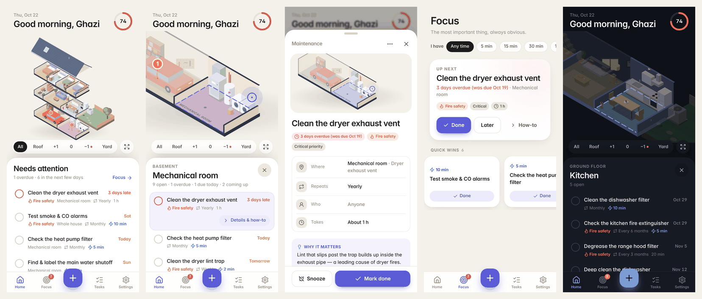
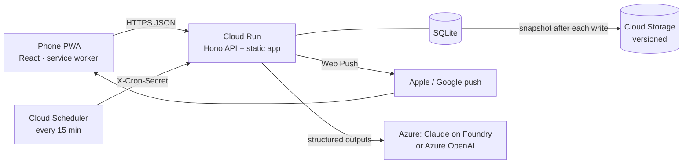
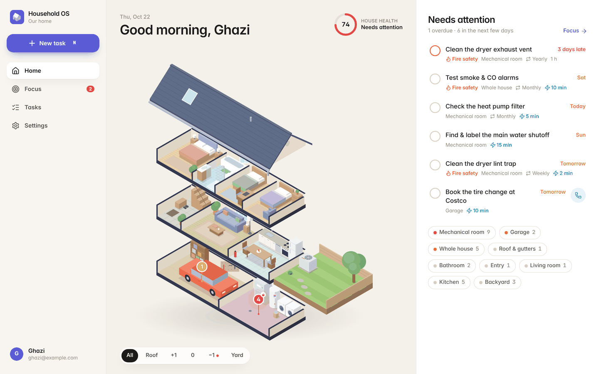

# Household OS

Home maintenance and shared to-dos for two, built around an interactive isometric map of the house.
An installable web app (PWA) for iPhone, with push reminders, an expert-seeded maintenance plan for a
newly bought house, and a prioritized to-do list designed for short pockets of free time.



## What's in v1

**The house is the interface.** The home screen is an exploded "dollhouse" of the actual house —
basement (garage, mechanical room), ground floor (entry, living room, kitchen), upper floor (three
bedrooms, bathroom), the roof and the backyard — drawn in code as isometric SVG.

- Rooms glow by status: red for overdue, orange for today, amber for coming up, green when up to date.
  Pins show counts, with a flame badge for overdue fire-safety work.
- Tap a room → the camera zooms in, the storey's walls grow, and the list shows that room's tasks.
- Tap a task → its room lights up and its fixture pulses (the dryer duct, the dishwasher, the heat
  pump's outdoor unit, the gutters, every smoke alarm…). Task details show the same live mini-map.
- A floor rail (Roof · +1 · 0 · −1 · Yard) focuses a storey; dark mode switches to a night palette
  with lit windows.

**Expert-seeded maintenance** — 28 items in three groups you choose at setup
([full list](docs/maintenance-plan.md)): the 13 from the PRD (dryer vent, lint trap, dishwasher filter
and deep clean, heat pump filter check/replacement/outdoor clearance/tune-ups, hot water tank flush,
garage, lawn, gutters, smoke & CO alarms), 11 inspector-recommended additions for this house
(winterizing outdoor faucets, range-hood grease, extinguisher, GFCI, bath fan, caulking, washer hoses,
radon…) and a 4-item new-home checklist (find the water main, rekey locks, label the panel…).

- Each item has *why it matters*, step-by-step instructions (tick them off), supplies, safety notes and
  a "pro job" flag. Fire-safety items are flagged everywhere.
- Completing resets the clock; seasonal items respect their season (mowing May–Oct) or fixed months
  (tune-ups every April & October). First due dates are staggered so a new home isn't 28 tasks overdue.
- Snooze, edit frequency/details, add your own, re-add from the expert plan, or ask the AI expert
  ("we just installed a water softener").

**To-dos built for real life**

- Private and shared lists; assign to each other — the assignee gets a push and sees who sent it.
- **Focus** ranks everything you could do now and explains why ("3 days overdue · Fire safety ·
  From Sam"), with **I have 5 / 15 / 30 min / 1 hour** filters and a quick-wins strip. Quick wins
  with a phone number get a one-tap **Call** button (dentist, Costco tires, car service).
- Optimistic updates with Undo on complete and delete.

**Reminders (Web Push)** — on iPhone, once the app is added to the Home Screen (iOS 16.4+):

| Reminder | Default | Notes |
| --- | --- | --- |
| Morning digest | 07:45 | Overdue, due today and coming up; skipped when nothing is due |
| Safety alerts | 18:30 | Overdue fire-safety/critical items on day 1, 4, 7… |
| Quick-win nudges | Weekdays 12:15, Sat 10:00 | Your "free moments" — editable, add your own |
| Assignments | Immediately | Held until quiet hours end (22:00–07:00 by default) |

### Answers to the PRD's open questions

1. **Reminder rules.** A task counts as "coming up" 3 days ahead for critical/high priority, 2 for
   normal, 1 for low — capped at a fifth of its cycle so weekly chores don't nag for days. Times above
   are per person and editable. Overdue safety items repeat every 3 days, never daily.
2. **"I have 10 minutes" filter.** Yes — Focus has 5/15/30/60-minute filters using each task's
   estimate (quick wins without one count as 10 minutes).
3. **Isometric detail in v1.** Fully illustrated rooms with ~20 linked fixtures, per-room status, storey
   focus and room zoom. Rooms can be renamed (e.g. "Bedroom 3" → "Office").

## Run it locally

Requires Node 22.9+.

```bash
npm install
npm run -s vapid >> .env   # optional: push keys
npm run dev             # API on :8787, app on http://localhost:5173 (proxied)
```

Open http://localhost:5173 and walk through setup. The service worker (offline shell, push) only runs
in a production build:

```bash
npm run build && npm start   # http://localhost:8787
```

Invite your partner from **Settings → Household → Invite your partner** (single-use link, 7 days).

## Install on iPhone

1. Open the app's URL in **Safari** → **Share** → **Add to Home Screen**.
2. Open it from the Home Screen, sign in, then **Settings → Notifications → Turn on**.
3. Tap **Test** to confirm a notification arrives. Each person does this on their own phone.

Push on iPhone only works from the Home Screen app, not from a Safari tab — the app explains this
when it detects Safari.

## Deploy to Google Cloud

Cloud Run (scales to zero) + a Cloud Storage bucket for the database + Cloud Scheduler for reminders.
For two people this stays within the free tiers; expect cents per month for storage.

```bash
gcloud auth login
export PROJECT_ID=your-project REGION=northamerica-northeast1

./deploy/gcp/setup.sh     # APIs, bucket, service account, secrets (generates VAPID + cron secret)
export VAPID_PUBLIC_KEY=… # printed by setup.sh
export VAPID_SUBJECT=mailto:you@example.com
./deploy/gcp/deploy.sh    # builds with Cloud Build, deploys, schedules reminders every 15 min
```

**How the data is kept.** The app uses SQLite. On Cloud Run the disk is ephemeral, so the server
restores the latest snapshot from Cloud Storage at startup and uploads a fresh snapshot after every
change, *before* responding — a write is durable once you see it. Uploads use generation
preconditions, the service is capped at one instance, and the bucket keeps 30 days of versions:
to roll back, copy an older version of `household.db` over the live object
(`gcloud storage cp gs://BUCKET/household.db#GENERATION gs://BUCKET/household.db`) and redeploy.

**Alternative:** any machine with Docker (a home server, or a free-tier GCE e2-micro VM):
`cp .env.example .env`, fill it in, `docker compose up -d`. Reminders then run in-process.

## AI on Azure (optional)

Two AI features use an LLM hosted on Azure; everything else works without them:

- **Ask the house expert** (Tasks → Maintenance → Expert plan): suggests maintenance for something new
  in the house, with steps and a sensible interval, ready to add to the plan.
- **Fill with AI** in the new-task sheet: "remind me to call the dentist next week" → title, date,
  quick-win flag, estimate, private/shared, assignee, phone number.

**Claude on Microsoft Foundry** (default): deploy a Claude model in your Foundry resource, then set
`ANTHROPIC_FOUNDRY_RESOURCE`, `ANTHROPIC_FOUNDRY_API_KEY` and `AI_MODEL` (the deployment name, default
`claude-opus-5-5`). Uses the official `@anthropic-ai/foundry-sdk` with schema-validated structured
outputs. Optionally set `AI_FALLBACK_MODEL` to a second deployment that retries requests the first
model declines.

**Azure OpenAI**: set `AI_PROVIDER=azure-openai`, `AZURE_OPENAI_ENDPOINT`, `AZURE_OPENAI_API_KEY` and
`AZURE_OPENAI_DEPLOYMENT` (JSON-schema structured outputs, API version `2024-10-21`).

On GCP, pass the key to `setup.sh` (`ANTHROPIC_FOUNDRY_API_KEY=… ./deploy/gcp/setup.sh`) and deploy
with `AI_PROVIDER=foundry ANTHROPIC_FOUNDRY_RESOURCE=… ./deploy/gcp/deploy.sh`.

## Configuration

| Variable | Purpose |
| --- | --- |
| `DATABASE_PATH` | SQLite file (default `data/household.db`) |
| `VAPID_PUBLIC_KEY`, `VAPID_PRIVATE_KEY`, `VAPID_SUBJECT` | Web Push keys (`npm run vapid`) |
| `CRON_SECRET` | Shared secret for `POST /api/cron/reminders` (`X-Cron-Secret` header) |
| `REMINDER_INTERVAL_MINUTES` | Run reminders in-process instead of via cron (VMs, compose) |
| `GCS_BUCKET`, `GCS_OBJECT` | Cloud Storage snapshot persistence (Cloud Run) |
| `APP_ORIGIN` | Public URL, used in invite links (optional) |
| `MAX_MEMBERS` | Household size limit (default 3) |
| `AI_PROVIDER` | `foundry`, `azure-openai` or `none` (auto-detected from keys) |

See [.env.example](.env.example) for the full list.

## How it's built



- **`src/shared`** — pure TypeScript domain used by both sides: calendar dates, recurrence, due states,
  zone health, prioritization with reasons, the reminder planner, and the expert plan. Unit-tested.
- **`src/server`** — Hono on Node 22, better-sqlite3, cookie sessions (scrypt passwords, 400-day
  sessions for the installed app), same-origin checks, Web Push outbox with dedupe keys, idempotent
  cron, Cloud Storage persistence, AI providers.
- **`src/client`** — React 19, Vite, Tailwind CSS v4, Motion, TanStack Query (optimistic updates),
  React Router, Workbox service worker. The house (`src/client/house`) is hand-built isometric SVG —
  no image assets — with animated cameras and walls.

```
src/shared     domain logic + tests          src/client/house     isometric renderer
src/server     API, persistence, push, AI    src/client/features  pages and sheets
e2e/           Playwright journeys           deploy/gcp           setup + deploy scripts
```

## Scripts

| Command | What it does |
| --- | --- |
| `npm run dev` | API + Vite dev server with hot reload |
| `npm run build` / `npm start` | Production build / run it |
| `npm test` | Unit + API tests (Vitest) |
| `npm run e2e` | End-to-end journeys in Chromium (Playwright) |
| `npm run typecheck`, `npm run lint` | TypeScript and ESLint |
| `npm run vapid` | Generate Web Push keys |
| `npm run icons` | Re-render app icons |

In development, `/__house` is a playground for the house renderer (focus states, fixtures, dark mode).

## Assumptions to double-check

- **Laundry is in the mechanical room.** The PRD lists a dryer but not where it is; the washer, dryer
  and dryer-vent tasks sit in the mechanical room. Move them in each task if not.
- **Northern-hemisphere seasons** (mowing May–Oct, tune-ups April/October, faucets winterized in
  October). Edit the frequency on the task if your climate differs.
- **Stylized layout.** Rooms are drawn as one row per floor in the right order; rename rooms in
  Settings. The default deploy region is Montréal (`northamerica-northeast1`); change `REGION` as needed.

## Next (PRD §10)

Smart weekend planning from the backlog, AI expansion when appliances are added from photos of their
rating plates, and sensor integrations (e.g. filter-change sensors).


