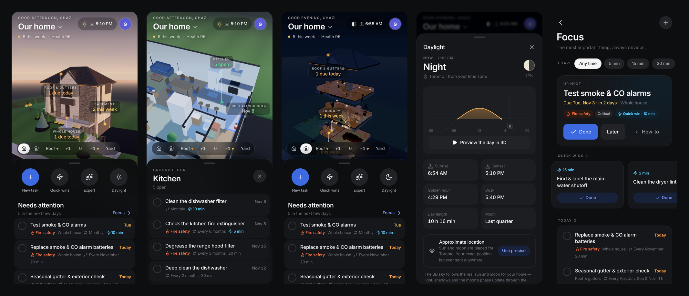
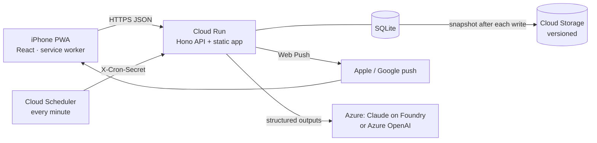
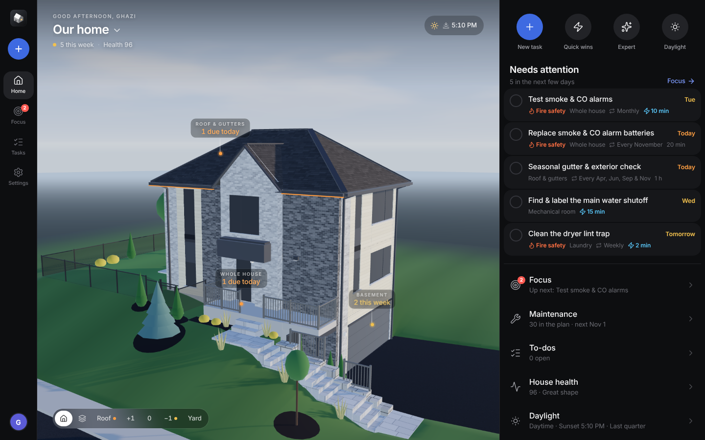

# Household OS

Home maintenance and shared to-dos for two, built around a live 3D model of the house under the real
sky. An installable web app (PWA) for iPhone, with push reminders, an expert-seeded maintenance plan for a
newly bought house, and a prioritized to-do list designed for short pockets of free time.

The interface takes its cues from the Tesla app: a dark, minimal home screen where the house is the hero,
status labels with leader lines pointing at the parts that need you, and a short list of rows underneath.



## What's in v1

**The house is the interface.** The home screen is a real-time 3D model of the actual house, built in
code with three.js from its floor plans (22 × 33 ft): basement (garage, family room, laundry,
mechanical room), ground floor (side entry, open living / dining / kitchen with the island, powder
room), upper floor (two bedrooms, an office, primary walk-in, bathroom with tub and separate shower), the roof
and the backyard.

The outside follows photos of the house: dark and light grey brick with a cream-siding stairwell
strip, the entry bay under its own front gable with the flat metal canopy over a recessed door, a hip
roof, the garage end in siding with its light brick corner column, and the porch with aluminum
railings. The lot is sloped the way it really is: the driveway runs gently down into the garage, a
stepped walkway climbs past an armour-stone wall (with a paved court and door under the porch), the
front lawn sits a few steps below the porch, and the fenced backyard is level with the ground floor —
the living room's porte-fenêtre opens straight onto the patio.

- **Drag to orbit, pinch or scroll to zoom**, two fingers to pan; double-tap (or the ⌖ button) resets
  the view. The camera flies smoothly between views and is kept close to the house.
- **Tesla-style labels.** Floors, the roof and the yard carry labels with leader lines ("BASEMENT · 1
  overdue"); outside, only what needs attention is labelled. Inside a room, its fixtures get their own
  labels (Dishwasher · Nov 8, Range hood · Nov 15) and tapping one selects its task.
- **Look inside.** The rail (House · Floors · Roof · +1 · 0 · −1 · Yard) or a tap on the house opens a
  storey: the ones above lift away, and whichever walls face the camera drop so the rooms read from any
  angle — orbit around and the cutaway follows. *Floors* stacks every storey like a dollhouse.
- Rooms glow by status (red overdue — pulsing, orange today, amber this week, green up to date). Tap a
  room → the camera moves in and the panel lists its tasks; tap a task → its fixture pulses with a
  locator ring (the dryer duct, the dishwasher, the heat pump's outdoor unit, the gutters, every
  smoke alarm…).
- A draggable bottom panel (quick actions · needs attention · Focus, Maintenance, To-dos, House health,
  Daylight, Settings) slides over the scene; the house stays centered in whatever space is left. Pages
  push over the home screen like a native navigation stack, and the scene pauses while it's covered.

**Prayer times.** The adhan times come from ICC Brossard's own timetable (the JSON feed behind
iccbrossard.com): the server reads it each day and stores it, and the app and notifications use it.
Jumu'ah entries are ignored, so Fridays use Dhuhr. If the feed can't be reached, that day falls back to
a calculation (ISNA, 15°, standard Asr, `src/shared/prayer.ts`) nudged by the mosque's latest offsets,
and the Daylight panel says so. The panel lists today's five prayers (and sunrise), the next one
highlighted with a countdown. Each member gets a push at Fajr, Dhuhr, Asr, Maghrib and Isha, on the
minute, plus a reminder 15 minutes before Asr to pray Dhuhr in time —
both can be turned off in Settings → Notifications.

**A live sky.** The sky over the house is computed for your home, right now:

- Everything follows the house: Saint-Philippe, QC, in Montréal time, whatever the phone's own time
  zone. The app sets its clock from the server's (NTP-synced), so a phone running fast or slow
  doesn't shift the sky, dates or prayer times.
- The sun and moon are placed with real astronomy (SunCalc/Meeus formulas, unit-tested against
  published sunrise times and moon phases).
- Daylight drives everything: the sky gradient, sunset glow and drifting clouds, stars at night, the
  moon's actual phase and tilt, sun and moon shadows, and the windows, porch lights and rooms warming
  up at dusk.
- **Daylight** panel: sunrise, sunset, golden hour, dusk, day length and moon phase on a 24-hour sun
  chart, plus **Preview the day in 3D** — a scrubber (or time-lapse) that runs the whole day over the
  house.
- Appearance can be Dark (default), Light, System, or **Sun**: dark from sunset to sunrise at home.

**Expert-seeded maintenance** — 30 items in three groups you choose at setup
([full list](docs/maintenance-plan.md)): the 13 from the PRD (dryer vent, lint trap, dishwasher filter
and deep clean, heat pump filter check/replacement/outdoor clearance/tune-ups, hot water tank flush,
garage, lawn, gutters, smoke & CO alarms), 13 inspector-recommended additions for this house
(sump pump test, air exchanger filters, winterizing outdoor faucets, range-hood grease, extinguisher,
GFCI, bath fan, caulking, washer hoses, radon…) and a 4-item new-home checklist (find the water main, rekey locks, label the panel…).

- Each item has *why it matters*, step-by-step instructions (tick them off), supplies, safety notes and
  a "pro job" flag. Fire-safety items are flagged everywhere.
- Completing resets the clock; seasonal items respect their season (mowing May–Oct) or fixed months
  (tune-ups every April & October). First due dates are staggered so a new home isn't 28 tasks overdue.
- Snooze, edit frequency/details, add your own, re-add from the expert plan, or ask the AI expert
  ("we just installed a water softener").

**To-dos built for real life**

- Private and shared lists; assign to each other — the assignee gets a push and sees who sent it.
- **Focus** ranks everything you could do now and explains why ("3 days overdue · Fire safety ·
  From Sam"), with **I have 5 / 15 / 30 min / 1 hour** filters and a quick-wins strip. Quick wins
  with a phone number get a one-tap **Call** button (dentist, Costco tires, car service).
- **Ask** on any task opens a chat with the AI expert, who sees all of the task's details (due date,
  steps, notes, history) — "what filter size do I buy?", "can I do this myself?".
- **Poke** sends the other person a push to have a look at a task (once per task every 10 minutes).
- Swipe a task left to reveal **Delete**. Optimistic updates with Undo on complete and delete.

**Reminders (Web Push)** — on iPhone, once the app is added to the Home Screen (iOS 16.4+):

| Reminder | Default | Notes |
| --- | --- | --- |
| Morning digest | 07:45 | Overdue, due today and coming up; skipped when nothing is due |
| Safety alerts | 18:30 | Overdue fire-safety/critical items on day 1, 4, 7… |
| Quick-win nudges | Weekdays 12:15, Sat 10:00 | Your "free moments" — editable, add your own |
| Assignments and pokes | Immediately | Day or night |
| Prayer times | Each adhan, on the minute | Times from ICC Brossard; plus a Dhuhr reminder 15 min before Asr |

### Answers to the PRD's open questions

1. **Reminder rules.** A task counts as "coming up" 3 days ahead for critical/high priority, 2 for
   normal, 1 for low — capped at a fifth of its cycle so weekly chores don't nag for days. Times above
   are per person and editable. Overdue safety items repeat every 3 days, never daily.
2. **"I have 10 minutes" filter.** Yes — Focus has 5/15/30/60-minute filters using each task's
   estimate (quick wins without one count as 10 minutes).
3. **House detail in v1.** A furnished 3D model with ~20 linked fixtures, per-room status, storey
   cutaways and room zoom (with the illustrated isometric house as fallback). Room names are fixed.

## Run it locally

Requires Node 22.9+.

```bash
npm install
npm run -s vapid >> .env   # optional: push keys
npm run dev             # API on :8787, app on http://localhost:5173 (proxied)
```

Open http://localhost:5173 and walk through setup. The service worker (offline shell, push) only runs
in a production build:

```bash
npm run build && npm start   # http://localhost:8787
```

Invite your partner from **Settings → Household → Invite your partner** (single-use link, 7 days).

## Install on iPhone

1. Open the app's URL in **Safari** → **Share** → **Add to Home Screen**.
2. Open it from the Home Screen, sign in, then **Settings → Notifications → Turn on**.
3. Tap **Test** to confirm a notification arrives. Each person does this on their own phone.

Push on iPhone only works from the Home Screen app, not from a Safari tab — the app explains this
when it detects Safari.

## Deploy to Google Cloud

Cloud Run (scales to zero) + a Cloud Storage bucket for the database + Cloud Scheduler for reminders.
For two people this stays within the free tiers; expect cents per month for storage.

```bash
gcloud auth login
export PROJECT_ID=your-project REGION=northamerica-northeast1

./deploy/gcp/setup.sh     # APIs, bucket, service account, secrets (generates VAPID + cron secret)
export VAPID_PUBLIC_KEY=… # printed by setup.sh
export VAPID_SUBJECT=mailto:you@example.com
./deploy/gcp/deploy.sh    # builds with Cloud Build, deploys, schedules reminders every minute
```

**How the data is kept.** The app uses SQLite. On Cloud Run the disk is ephemeral, so the server
restores the latest snapshot from Cloud Storage at startup and uploads a fresh snapshot after every
change, *before* responding — a write is durable once you see it. Uploads use generation
preconditions, the service is capped at one instance, and the bucket keeps 30 days of versions:
to roll back, copy an older version of `household.db` over the live object
(`gcloud storage cp gs://BUCKET/household.db#GENERATION gs://BUCKET/household.db`) and redeploy.

**Alternative:** any machine with Docker (a home server, or a free-tier GCE e2-micro VM):
`cp .env.example .env`, fill it in, `docker compose up -d`. Reminders then run in-process.

## AI on Azure (optional)

Three AI features use an LLM hosted on Azure; everything else works without them:

- **Ask the house expert** (Tasks → Maintenance → Expert plan): suggests maintenance for something new
  in the house, with steps and a sensible interval, ready to add to the plan.
- **Ask** on any task: a chat about that task, with all its details sent along with each question.
  The conversation stays on the device and isn't stored on the server.
- **Fill with AI** in the new-task sheet: "remind me to call the dentist next week" → title, date,
  quick-win flag, estimate, private/shared, assignee, phone number.

**Claude on Microsoft Foundry** (default): deploy a Claude model in your Foundry resource, then set
`ANTHROPIC_FOUNDRY_RESOURCE`, `ANTHROPIC_FOUNDRY_API_KEY` and `AI_MODEL` (the deployment name, default
`claude-opus-5-5`). Uses the official `@anthropic-ai/foundry-sdk` with schema-validated structured
outputs. Optionally set `AI_FALLBACK_MODEL` to a second deployment that retries requests the first
model declines.

**Azure OpenAI**: set `AI_PROVIDER=azure-openai`, `AZURE_OPENAI_ENDPOINT`, `AZURE_OPENAI_API_KEY` and
`AZURE_OPENAI_DEPLOYMENT` (JSON-schema structured outputs, API version `2024-10-21`).

On GCP, pass the key to `setup.sh` (`ANTHROPIC_FOUNDRY_API_KEY=… ./deploy/gcp/setup.sh`) and deploy
with `AI_PROVIDER=foundry ANTHROPIC_FOUNDRY_RESOURCE=… ./deploy/gcp/deploy.sh`.

## Configuration

| Variable | Purpose |
| --- | --- |
| `DATABASE_PATH` | SQLite file (default `data/household.db`) |
| `VAPID_PUBLIC_KEY`, `VAPID_PRIVATE_KEY`, `VAPID_SUBJECT` | Web Push keys (`npm run vapid`) |
| `CRON_SECRET` | Shared secret for `POST /api/cron/reminders` (`X-Cron-Secret` header) |
| `REMINDER_INTERVAL_MINUTES` | Run reminders in-process instead of via cron (VMs, compose) |
| `GCS_BUCKET`, `GCS_OBJECT` | Cloud Storage snapshot persistence (Cloud Run) |
| `APP_ORIGIN` | Public URL, used in invite links (optional) |
| `MAX_MEMBERS` | Household size limit (default 3) |
| `AI_PROVIDER` | `foundry`, `azure-openai` or `none` (auto-detected from keys) |

See [.env.example](.env.example) for the full list.

## 3D, performance and fallbacks

- The 3D engine (three.js, React Three Fiber, camera-controls) is a separate chunk (~260 KB gzipped)
  loaded only when the house is on screen and precached for offline use. Until it arrives — or on a
  device without WebGL — the same sky is drawn as a gradient behind the illustrated SVG house, which
  keeps every room tappable.
- Settings → 3D house: graphics quality (Saver turns off shadows and renders at 1×), labels, a slow
  idle orbit, and which way the front of the house faces (by default away from the midday sun, so the
  default view looks toward the sun and moon).
- Rendering stops whenever the home screen is covered by a page, the panel is fully expanded, or the
  app is in the background. Reduced-motion turns off pulsing, drifting clouds and camera flights.

## How it's built



- **`src/shared`** — pure TypeScript domain used by both sides: calendar dates, recurrence, due states,
  zone health, prioritization with reasons, the reminder planner, and the expert plan. Unit-tested.
- **`src/server`** — Hono on Node 22, better-sqlite3, cookie sessions (scrypt passwords, 400-day
  sessions for the installed app), same-origin checks, Web Push outbox with dedupe keys, idempotent
  cron, Cloud Storage persistence, AI providers.
- **`src/client`** — React 19, Vite, Tailwind CSS v4, Motion, TanStack Query (optimistic updates),
  React Router, Workbox service worker, Inter. The 3D house (`src/client/scene`) is React Three Fiber:
  a layout model, furniture as data, a sky shader, and an HTML label layer projected every frame. The
  illustrated isometric SVG house (`src/client/house`) remains for mini-maps and as the fallback.
- **`src/shared/astro.ts`** — sun and moon positions, sun times, moon illumination and phase names;
  `src/shared/timezones.ts` maps every IANA time zone to its principal city (generated from tzdata).

```
src/shared     domain logic, astronomy + tests   src/client/scene     3D house, sky, labels
src/server     API, persistence, push, AI        src/client/house     isometric SVG renderer
e2e/           Playwright journeys               src/client/features  pages and sheets
```

## Scripts

| Command | What it does |
| --- | --- |
| `npm run dev` | API + Vite dev server with hot reload |
| `npm run build` / `npm start` | Production build / run it |
| `npm test` | Unit + API tests (Vitest) |
| `npm run e2e` | End-to-end journeys in Chromium (Playwright) |
| `npm run typecheck`, `npm run lint` | TypeScript and ESLint |
| `npm run vapid` | Generate Web Push keys |
| `npm run icons` | Re-render app icons |
| `npm run timezones` | Regenerate the time-zone → coordinates table from tzdata |

In development, `/__scene` is a playground for the 3D house (`?view=ground&zone=kitchen&fixture=dishwasher&hour=17.5`)
and `/__house` one for the illustrated house. The end-to-end suite renders WebGL in software; if your
Playwright browsers don't match the pinned version, point it at any Chromium with `PW_CHROMIUM_PATH`.

## Assumptions to double-check

- **What the plans don't show.** The heat pump's indoor unit is drawn in the mechanical room next to
  the water heater and air exchanger, and its outdoor unit in the backyard. Move a task's room or
  fixture if yours are elsewhere.
- **Northern-hemisphere seasons** (mowing May–Oct, tune-ups April/October, faucets winterized in
  October). Edit the frequency on the task if your climate differs.
- **Layout from the floor plans and photos.** Rooms, doors and the main fixtures follow the plans;
  the exterior (cladding, windows, entry bay, roof, porch, grades) follows photos of the front and the
  garage end, with sizes estimated from them. The two photos disagree on handedness (the garage-end
  photo shows the entry on the other side), so the model follows the front photo; the long side
  without windows is drawn as a plain brick wall. Room names are fixed. The default
  deploy region is Montréal (`northamerica-northeast1`); change `REGION` as needed.
- **Where the sun is.** The sky assumes the front of the house faces away from the midday sun. Set
  the real direction in Settings → 3D house.
- **Prayer times** follow ICC Brossard (`MOSQUE_PRAYER_URL` to point elsewhere). The fallback
  calculation uses ISNA with the standard Asr.

## Next (PRD §10)

Smart weekend planning from the backlog, AI expansion when appliances are added from photos of their
rating plates, and sensor integrations (e.g. filter-change sensors).


